# 🎮 Awesome Cloud Gaming Clients & Console Portals

  

  
  
  
  
  
  

---

## 🌟 Top Cloud Gaming Clients & Console Portals Ecosystem

**A curated collection of SaaS/hosted platforms, open-source streaming software, and remote console portals for PC, Linux, macOS, Android, iOS, Steam Deck, Raspberry Pi, and Smart TVs.**

> Low-latency WebRTC/HEVC/AV1 game streaming, self-hosted GPU rigs, remote play wrappers, and console clients.

*Last updated: November 2026* ⚡

---

## 📑 Table of Contents
- [📊 Sector Overview & Market Dynamics](#-sector-overview--market-dynamics)
- [☁️ SaaS/Hosted Platforms](#-saashosted-platforms)
- [🔓 Open-Source GitHub Projects](#-open-source-github-projects)
- [🛠️ Frameworks for Building Custom Systems](#-frameworks-for-building-custom-systems)
- [🤝 How to Contribute](#-how-to-contribute)
- [💖 Support](#-support)
- [📈 Star History](#-star-history)
- [⚠️ Disclaimer](#-disclaimer)

---

## 📊 Sector Overview & Market Dynamics

The global cloud gaming sector is estimated at **$4.8B to $6.2B in 2026**, on track to exceed **$15B–$40B+ by 2030** with an annual growth rate (CAGR) topping 30%. The market exhibits a **moderately concentrated, bifurcated structure**: while foundational global cloud streaming infrastructure is dominated by hyperscalers and platform giants (Microsoft Xbox Cloud Gaming, NVIDIA GeForce NOW, Amazon Luna, and Sony PlayStation), the client applications, regional distributions, and self-hosted game streaming tools remain highly fragmented and community-driven.

---

## ☁️ SaaS/Hosted Platforms

| Platform | Valuation / Company Size | Pricing | Free Tier / Trial Limits | Description |
| :--- | :--- | :--- | :--- | :--- |
| 🟢 **[NVIDIA GeForce NOW](https://nvidia.com)** | ~$3.5T Market Cap (NVIDIA) | $9.99/mo (Priority/Performance) | Free forever plan: 1-hour session limit, basic server rig, ad-supported queue | Leading cloud gaming service streaming owned PC libraries from Steam, Epic Games, Xbox, and Ubisoft on RTX-class cloud servers up to 4K/120fps. |
| 🎮 **[Xbox Cloud Gaming (Microsoft xCloud)](https://xbox.com)** | ~$3.1T Market Cap (Microsoft) | $22.99/mo (Game Pass Ultimate) | Free tier: Free play on Fortnite only, ad-supported with 30–60 min per session limit | Cloud game streaming service included with Xbox Game Pass enabling instant browser, smart TV, console, and mobile access to hundreds of Xbox titles. |
| 🌙 **[Amazon Luna](https://amazon.com)** | ~$2.2T Market Cap (Amazon) | $9.99/mo (Luna+) | 7-day free trial (Luna+ full catalog access); or free rotating games included with Amazon Prime | Cloud gaming platform built on AWS infrastructure featuring Prime Gaming integration, Ubisoft+ channels, and low-latency Wi-Fi Luna Controller support. |
| 🕹️ **[PlayStation Cloud Gaming](https://playstation.com)** | ~$155B Market Cap (Sony Group) | $19.99/mo or $159.99/yr (PS Plus Premium) | 7-day free trial (available selectively to new PS Plus subscribers on PSN) | Sony's cloud streaming platform delivering PlayStation 5, PS4, and classic PlayStation titles directly to PS5 consoles, PlayStation Portal, and Windows PCs. |
| 📦 **[Blacknut](https://blacknut.com)** | $215M Total Funding (Digital Alpha) | $15.99/mo | 14-day promotional free trial (via select partners) / 15–30 min free demo previews without account | Family-friendly cloud gaming subscription platform hosting a curated catalog of over 500 indie, casual, and console-style titles across smart TVs and browsers. |
| 🚀 **[Boosteroid](https://boosteroid.com)** | ~$125M Annual Revenue | €9.99/mo (or €7.49/mo billed annually) | No free tier or trial; requires paid month-to-month subscription to test low-latency streaming | Independent European cloud gaming platform offering browser- and app-based 4K streaming for PC games across Windows, macOS, Linux, Android, and smart TVs. |
| 🖥️ **[Shadow PC](https://shadow.tech)** | ~$35M Annual Revenue (Synfonium / Octave Klaba) | $37.99/mo (Lite / Neo Tier) | No free tier or trial; full dedicated Windows 11 cloud PC requires 1-month paid commitment | Full Windows 11 cloud gaming PC service providing dedicated NVIDIA GPU hardware, mod support, and unrestricted access to any PC game launcher. |
| 👾 **[Antstream Arcade](https://antstream.com)** | ~$30M Total Funding / ~$10M Rev | $4.99/mo or $39.99/yr | Free account allows browsing 1,300+ retro titles; free trials (e.g. 7-day) available selectively on mobile/iOS app stores | Cloud retro gaming platform streaming over 1,300 licensed arcade, console, and home-computer classics with global leaderboards and mini-game challenges. |
| 🎯 **[Utomik](https://utomik.com)** | ~$3.7M Historical Revenue ($3.5M Funding) | $8.99/mo (Cloud Plan) | 14-day free trial with full access to PC and cloud library across smart TVs and Android | Cloud and hybrid instant-play PC gaming subscription platform streaming indie and classic titles across PC, Android, and smart TVs. |
| ⚡ **[AirGPU](https://airgpu.com)** | ~$100K ARR (Bootstrapped) | $0.65/hr + $7.00/mo SSD storage base | No free tier, free trial, or sign-up credits; strictly pay-as-you-go hourly plus storage billing | Pay-as-you-go cloud gaming virtual machine provider pre-configured with Parsec and Moonlight for custom high-FPS PC game streaming. |

---

## 🔓 Open-Source GitHub Projects

Sorted descending by GitHub Stars_Count:

1. **[Sunshine](https://github.com/LizardByte/Sunshine)**  🌟  
   Flagship self-hosted open-source game streaming host and modern replacement for NVIDIA GameStream. Supports AMD, Intel, and NVIDIA hardware encoding with ultra-low latency, Web UI configuration, and cross-platform capture.

2. **[Moonlight Qt](https://github.com/moonlight-stream/moonlight-qt)**  🌟  
   Cross-platform open-source game streaming client supporting 4K 120fps HDR video decoding, multi-channel 5.1/7.1 surround sound, and gamepad pass-through on Windows, macOS, Linux, and Steam Deck.

3. **[Playnite](https://github.com/JosefNemec/Playnite)**  🌟  
   Open-source video game library manager and console-like full-screen couch portal for PC gaming, emulator frontends, and unified cloud gaming launcher integration.

4. **[FreeRDP](https://github.com/FreeRDP/FreeRDP)**  🌟  
   High-performance open-source Remote Desktop Protocol implementation featuring hardware acceleration (H.264/AVC444/AV1) used extensively in cloud GPU virtual machine streaming.

5. **[Heroic Games Launcher](https://github.com/Heroic-Games-Launcher/HeroicGamesLauncher)**  🌟  
   Native open-source games launcher for Linux, Windows, and macOS that unifies Epic Games, GOG, and Amazon Games with Wine/Proton and controller-friendly TV/Steam Deck navigation.

6. **[Moonlight Android](https://github.com/moonlight-stream/moonlight-android)**  🌟  
   Official Android client for Moonlight game streaming supporting Android TV, tablets, foldable phones, external controllers, and high-refresh-rate 120Hz decoding.

7. **[Docker Steam Headless](https://github.com/Steam-Headless/docker-steam-headless)**  🌟  
   Containerized Steam client and game server with NVIDIA/AMD GPU acceleration, audio routing, and Sunshine/Moonlight streaming built for headless Linux servers and homelabs.

8. **[EmulatorJS](https://github.com/EmulatorJS/EmulatorJS)**  🌟  
   Self-hosted browser-based retro gaming emulation portal that compiles Libretro cores to WebAssembly with complete gamepad mapping, cloud save states, and zero-install web streaming.

9. **[WebRTC-Streamer](https://github.com/mpromonet/webrtc-streamer)**  🌟  
   High-performance HTML5 video streaming server using WebRTC and hardware-accelerated video codecs (H.264, H.265, VP9) for sub-second latency browser playback.

10. **[Chiaki-ng](https://github.com/streetpea/chiaki-ng)**  🌟  
    Actively maintained open-source PlayStation 4 and PlayStation 5 Remote Play client featuring HDR decoding, DualSense adaptive triggers/haptics, touchpad emulation, and Steam Deck optimizations.

11. **[Greenlight](https://github.com/unknownskl/greenlight)**  🌟  
    Open-source Electron desktop client for Xbox Cloud Gaming (xCloud) and local Xbox Home console remote play, designed with low-latency controller support for Steam Deck and Linux.

12. **[Universal x86 Tuning Utility Handheld](https://github.com/JamesCJ60/Universal-x86-Tuning-Utility)**  🌟  
    Open-source TDP and power tuning portal for AMD and Intel handheld gaming consoles (ROG Ally, Legion Go, Steam Deck) optimizing battery efficiency during cloud streaming sessions.

13. **[Selkies-GStreamer](https://github.com/selkies-project/selkies-gstreamer)**  🌟  
    Open-source hardware-accelerated WebRTC remote desktop and cloud gaming streaming engine built on GStreamer for NVIDIA and VAAPI cloud GPU instances in Docker/Kubernetes.

14. **[CloudRetro](https://github.com/giongto35/cloud-game)**  🌟  
    Cloud gaming architecture written in Go using WebRTC and Libretro cores to deliver instant, distributed multiplayer retro gaming straight to modern web browsers.

15. **[Wolf](https://github.com/games-on-whales/wolf)**  🌟  
    Docker-native multi-user game streaming server compatible with Moonlight clients. Supports virtual Wayland/Xorg sessions and isolated Steam game containers on shared host GPUs.

16. **[Better xCloud](https://github.com/redphx/better-xcloud)**  🌟  
    Feature-packed open-source userscript and Android client elevating Xbox Cloud Gaming with 1080p stream bitrate unlocking, Clarity Boost sharpening, region selection, and DualSense gyro integration.

17. **[Moonlight iOS](https://github.com/moonlight-stream/moonlight-ios)**  🌟  
    Open-source iOS and tvOS client for Sunshine and NVIDIA GameStream supporting Apple Silicon iPads, iPhones, Apple TV 4K, ProMotion 120Hz displays, and MFi/Bluetooth controllers.

18. **[Moonlight Embedded](https://github.com/moonlight-stream/moonlight-embedded)**  🌟  
    Lightweight, embedded C implementation of Moonlight engineered specifically for single-board computers (Raspberry Pi, ODROID), embedded consoles, and low-spec Linux devices.

19. **[Duo Stream](https://github.com/DuoStream/Duo)**  🌟  
    Multi-seat Windows game streaming portal enabling simultaneous independent gaming sessions on a single host PC, routed to multiple Moonlight client devices.

20. **[Parsec Cloud Preparation Tool](https://github.com/parsec-cloud/Parsec-Cloud-Preparation-Tool)**  🌟  
    Automation scripts for provisioning and optimizing cloud GPU virtual machines (AWS, Azure, Paperspace, GCP) for low-latency game streaming and remote play.

21. **[GeForce NOW Electron](https://github.com/hmlendea/gfn-electron)**  🌟  
    Lightweight Linux desktop wrapper for NVIDIA GeForce NOW offering native desktop integration, rich system notifications, Discord Rich Presence, and gamepad support.

22. **[rafaelngp/xbox-cloud-gaming-ps5](https://github.com/rafaelngp/xbox-cloud-gaming-ps5)**  🌟  
    Web-based portal that wraps Xbox Cloud Gaming with optimized DualSense controller mapping for streaming Xbox games through PlayStation 5 internal browser portals.

---

## 🛠️ Frameworks for Building Custom Systems

- 🚀 **Self-Hosted Game Rig**: Deploy **Sunshine** (host) on your gaming PC/GPU server and connect via **Moonlight Qt / Android / iOS** (client) for 4K 120fps HDR streaming over LAN or Tailscale/WireGuard VPNs.
- 🐳 **Multi-Tenant GPU Cloud**: Run **Wolf** or **Docker Steam Headless** inside Docker on Linux servers to spin up isolated gaming sessions per user from a shared workstation or server rack.
- 🎮 **Enhanced Console Remote Play**: Use **Chiaki-ng** for low-latency PlayStation 4/5 Remote Play with full DualSense haptics, or **Greenlight** and **Better xCloud** for Xbox Cloud Gaming and Home console streaming.
- 🌐 **Browser-First Cloud Gaming**: Embed **CloudRetro** or **EmulatorJS** to run WebRTC- and WebAssembly-powered retro console streams without needing client-side app installations.

---

## 🤝 How to Contribute

Contributions are welcome! To propose updates or add new projects:

1. 🍴 **Fork the repository**.
2. 📝 **Edit `README.md`** following the existing table or list format.
3. 🔍 Ensure links are active, descriptions are concise and factual, and specific starting pricing / free tier limits are provided for SaaS products.
4. 🚀 **Submit a Pull Request** with a brief summary of the changes.

---

## 💖 Support

Thank you for exploring this curated guide to cloud gaming and console portal technologies! 🎮

If this project saved you time, enhanced your streaming setup, or aided your development, please consider showing your support:

- ⭐ **Star this repository** to help others discover it.
- 🍴 **Fork & Share** with your fellow gamers, homelab enthusiasts, and developers on Discord, Reddit, and X/Twitter.
- ☕ **Buy me a coffee / Sponsor**: If you'd like to support continued maintenance and future updates, please consider sponsoring via my [GitHub Sponsors Dashboard](https://github.com/sponsors/ishandutta2007) — where you can also claim profile badges, README shoutouts, or prioritized feature requests!

---

## 📈 Star History

---

## ⚠️ Disclaimer

- This list is **community-curated** for educational, benchmarking, and research purposes and is not an endorsement.
- Third-party wrappers, scripts, and alternative clients for commercial services (GeForce NOW, Xbox Cloud Gaming, PlayStation Plus) are unofficial community creations; always review and comply with official platform terms of service.
- Self-hosted servers exposed across the public internet should be secured using private virtual networks (e.g., WireGuard, Tailscale) or strict firewall policies.

---

  <b>Built for gamers, Steam Deck enthusiasts, homelab architects, and open-source streaming developers.</b> 
  Let's keep game streaming fast, private, and accessible on every display! 🚀

